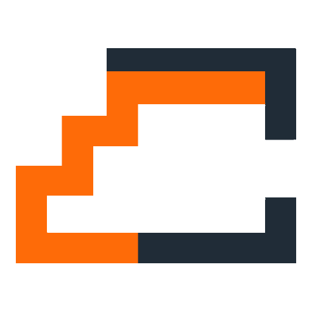

<p align="center"></p>

<h1 align="center">Code Shape Kit</h1>

Get your Python project into good shape, and keep it there while coding agents write the code.

Code Shape Kit finds the structural problems your project has today, like oversized files, tangled functions, copy-paste and broken layers, and tells your agent how to fix each one. Every fix becomes the new standard. From then on, each pull request is checked so new problems don't get in, and if someone loosens a rule to get a green check, reviewers see it.

Why: agents copy what's already in the code. OpenAI saw Codex "replicates patterns that already exist in the repository—even uneven or suboptimal ones" ([Harness engineering](https://openai.com/index/harness-engineering/)). Lauren Tan explains how one workaround becomes the pattern in her talk [All Code Is Slop (Except Mine)](https://www.youtube.com/watch?v=O_zcc6Xl12g).

## With and without the kit

The same app after six months of agent pull requests. Without the kit, big files keep growing and one bad pattern gets copied. With it, the agent splits code into new packages, old problems can't grow, and each improvement becomes the new limit.


## Try it with your coding agent

Paste this into your coding agent:

> Read https://github.com/emanuilo/code-shape-kit/blob/main/docs/agents.md and set up Code Shape Kit for this project. Show me the proposed rules before recording the baseline.

Requires Python 3.11.4+ and a `pyproject.toml`.

<details>
<summary>Prefer to set it up yourself?</summary>

```bash
pip install "code-shape-kit[tools] @ git+https://github.com/emanuilo/code-shape-kit@v0.3.0"
code-shape init        # drafts the config, a CI workflow and CODEOWNERS
code-shape check       # shows what is wrong today
code-shape baseline    # records today's problems as the starting point
```

Then:

1. Review the guesses `init` wrote into `pyproject.toml`, especially the layer order.
2. Commit. The CI workflow runs `code-shape check` on every pull request.
3. In `.github/CODEOWNERS`, replace `@your-org/architects` with your reviewers and turn on
   "Require review from Code Owners", so rule changes need a human to merge.

</details>

<details>
<summary>What else does it catch?</summary>

Beyond what a linter catches line by line:

1. **Making an old mess bigger.** A file, class or function that's already too big or too tangled can't grow further while you fix it. This is checked per function, not just per file.
2. **Copy-pasting code into another file.** A block of 10+ lines that already exists elsewhere fails, even when an earlier copy is already accepted as old debt.
3. **Breaking the layers.** The database code imports the web code, or one feature reaches into another feature's internals. You set the rules once in the config, and a broken one always fails.
4. **Import cycles.** Two modules that import each other, directly or through others.
5. **Modules that depend on everything.** One module importing too many others.
6. **Dumping-ground folders and god classes.** A folder with too many modules or too much code, folders nested too deep, a class with too much state or too many methods.
7. **Reading env vars or calling an SDK from anywhere.** Only the module you name (e.g. `config.py`) may do it.
8. **Silencing instead of fixing.** Every new `# noqa`, `# type: ignore` or `# pylint: disable` is counted per function and fails.
9. **Switching checks off to get green.** Raising a limit, skipping a check, re-recording the known problems, weakening an import rule or a type-checker setting. The check still passes, but the pull request lists every loosened rule for a human to approve.
10. **Leaving dead code and type errors behind.** Unused functions and new type errors fail. Type errors are tracked per function, so fixing one and adding another still fails.

</details>

## Why not just use Ruff?

Ruff catches lint problems. Code Shape Kit pairs it with tools that check complexity and dependencies, with rules and a CI workflow you can use as a starting point. You review the rules for your project instead of choosing and wiring up every tool yourself.

The kit also remembers what your code looks like today. If an agent makes a tangled function more complex or introduces a forbidden import, the check fails. If it loosens a rule to get back to green, reviewers can see exactly what changed.

It runs locally or in CI. It doesn't replace tests or code review, and there's no hosted dashboard.

---

[Agent setup](docs/agents.md) · [Checks and configuration](docs/reference.md) · [Choosing project boundaries](docs/designing-the-shape.md) · [Example project](examples/tidy_app) · [MIT license](LICENSE)
