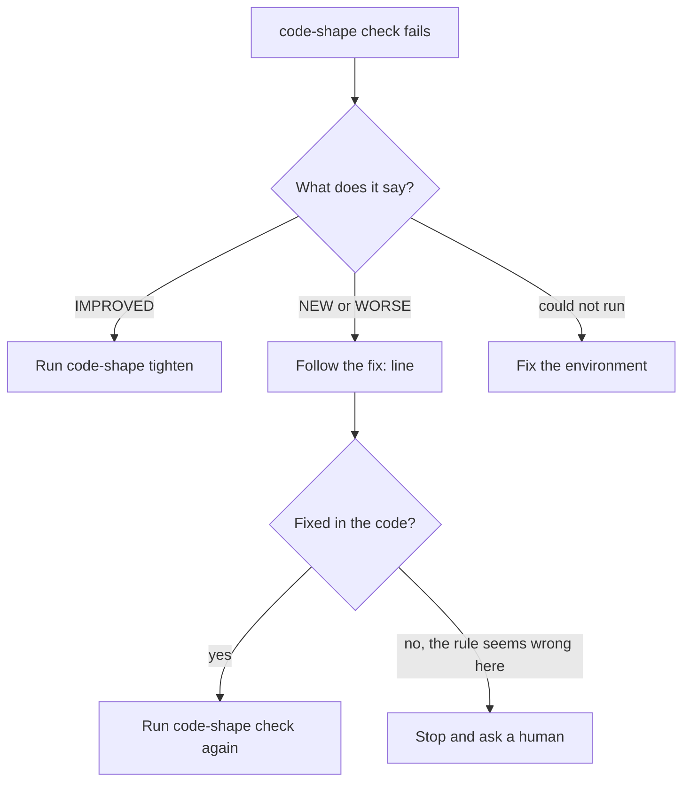

# code-shape-kit for coding agents

This page is for a coding agent. Either a human asked you to set code-shape-kit up in a
project, or you are working in a project that already uses it. It tells you what to do in
both cases, and what not to do.

The kit checks the **shape** of a Python project: how big files and functions get, which
modules import which, copy-pasted code, swallowed errors, comments that silence tools.
Problems the project already had are listed in a **baseline** file and tolerated. Anything
new or worse fails. Every change that makes the checks easier to pass is reported to a
human. The full list of checks and settings is in [reference.md](reference.md).

## The rules

1. When `code-shape check` fails, fix the code. Read the `fix:` line and do that.
2. Never get a check green by changing the rules. That means: don't run
   `code-shape baseline`, don't edit the baseline file, don't add `# noqa`,
   `# type: ignore`, `# pylint: disable` or similar comments, don't delete type annotations,
   and don't change `[tool.shape]`, `[tool.importlinter]`, `[tool.vulture]`,
   `[tool.deptry]`, `[tool.mypy]` or the dead-code whitelist.
3. Don't rename or move code just to dodge a check. A moved problem is a new problem.
4. If you believe a rule is wrong for this case, stop and ask a human. Explain the finding,
   what you tried, and what change to the rules you would suggest.
5. `code-shape tighten` is always allowed. It only shrinks the baseline.

Rule 2 is not only a request. In CI, `code-shape check --base origin/main` lists every such
change under "RULES LOOSENED", and CODEOWNERS makes a human approve the files that hold the
rules. A loosened rule will be seen.

## Set the kit up in a project

Do these steps in order. Stop at step 6 for the human's answer, and report back at the
end; don't commit unless asked.

**1. Check the project.** You need a `pyproject.toml` and Python 3.11.4 or newer. If
there is no `pyproject.toml`, stop and ask: which build backend and metadata a project
needs is not your call. The project itself must be installed in the same environment as
the kit (mypy and deptry need its dependencies).

**2. Install the kit**, pinned to a release:

```bash
pip install "code-shape-kit[tools] @ git+https://github.com/emanuilo/code-shape-kit@v0.3.0"
```

The `[tools]` extra installs the exact versions of ruff, pylint, complexipy, import-linter,
vulture, deptry and mypy the kit was tested with. If the project lists dev dependencies,
add the same line there.

**3. Run `code-shape init --dry-run`**, read what it would write, then run `code-shape init`.
It appends `[tool.shape]` and `[tool.importlinter]` to `pyproject.toml` and writes
`.github/workflows/code-shape.yml` and `.github/CODEOWNERS`. It never overwrites anything;
the summary lists what it left alone. Details: [What `init` writes](reference.md#what-init-writes).

**4. Review the guesses** in `pyproject.toml`:

- `packages`: the top-level package(s) to check.
- `config_modules`: the only modules allowed to read environment variables. init picks
  only an obvious one (`config.py`, `settings.py`, ...). Other modules that read the
  environment will fail `banned-api`: that is expected.
- The layers contract: init drafts it from today's imports, so it shows what the code
  does, not what it should do. Read [designing-the-shape.md](designing-the-shape.md) and
  compare. If the order looks wrong (for example the database module sits above the web
  routes), say so to the human rather than quietly rewriting it. Imports that break the
  drafted order are listed under `ignore_imports`: leave them there and mention them.
- Adapters (recommended): if the project uses an outside SDK (a database client, a payment
  API, `requests`), propose a `[tool.shape.banned_api]` entry so only its adapter module
  may import it. See [Restricted APIs](reference.md#restricted-apis-banned_api).
- `output_modules`: only `cli.py` and `__main__.py` may `print()` by default. If another
  module is meant to print (a report writer, a second entry point), propose adding it.
- `logger_objects`: `except Exception` that logs with `logger.exception(...)` passes for
  `logging` and loguru. If the project has its own logger object, propose listing it
  (`"myapp.log.logger"`), or its deliberate catch-alls will fail `swallowed-errors`.

Don't raise limits so that today's code passes. That is what the baseline is for. Paths in
these settings are relative to the project root (with the `src/` layout,
`src/myapp/config.py`). All settings: [Settings](reference.md#settings).

**5. Run `code-shape check`.**

- New or small project with few findings: fix them, so no baseline is needed.
- Existing project: run `code-shape report --trend 8` and note the worst findings and the
  hotspots.
- "these checks could not run" means the environment is missing something (often the
  project itself isn't installed). Fix that before you go on.

**6. Show the human the proposed rules, and wait.** Before any baseline is recorded, list:

- the guesses and your proposals from step 4 (packages, config modules, layer order and
  the `ignore_imports` it needed, adapters, output modules, logger objects), and anything
  you changed from what `init` wrote;
- how many problems `check` found, and the worst few.

Let them correct the rules first. A baseline recorded against the wrong rules locks the
wrong problems in.

**7. Record the baseline** (existing project, once the human agrees): run
`code-shape baseline` once to record today's problems as the starting point. This is the
one time running `baseline` is part of the job, because the human asked you to set the kit
up. If it says a check could not run, fix the environment and run it again. Run
`code-shape check` again: it should pass.

**8. Tell future agents the rules.** Add this to the project's `AGENTS.md` or `CLAUDE.md`
(create one if the project has none):

```markdown
## Code shape

Run `code-shape check` before you finish. Fix what it reports: read the `fix:` line.
Never run `code-shape baseline`, add `# noqa` / `# type: ignore` / `# pylint: disable`,
or edit `[tool.shape]`, the import-linter contracts or the baseline to get it green.
If a rule seems wrong, stop and ask. `code-shape tighten` is fine: it only locks in
improvements. Guide: https://github.com/emanuilo/code-shape-kit/blob/main/docs/agents.md
```

**9. Hand over to the human.** List:

- the files to commit: `pyproject.toml`, the baseline file, `.github/workflows/code-shape.yml`,
  `.github/CODEOWNERS` and the `AGENTS.md` / `CLAUDE.md` change;
- the number of baselined problems, and the hotspots to pay down first (after each fix,
  `code-shape tighten`);
- in `.github/CODEOWNERS`, replace `@your-org/architects` with the people who approve rule
  changes. If the project already had a CODEOWNERS file, init left it alone: the template's
  lines need adding to it;
- on GitHub, turn on "Require review from Code Owners" in the branch protection rules, and
  make the code-shape check required, so a rule change can't merge without a code owner.

## When a check fails

A failure looks like this:

```text
WORSE (was 640): [file-lines] File too long
  at shop/orders.py - 660 lines (limit 500)
  why: Long files usually hold more than one job, so a change in one job risks breaking the other.
  fix: Split the file by job: move each group of related functions/classes into its own module in the same package.
```

- `NEW`: a problem that wasn't there before. Fix it.
- `WORSE (was N)`: a problem the baseline tolerates got bigger. Bring it back to N or
  below. Better: fix it.
- `IMPROVED`: a known problem got smaller, but the baseline still has the old number. Run
  `code-shape tighten` and include the baseline change. This is the ratchet: from now on
  the lower number is the limit.
- `[file-lines]` is the check id. [reference.md](reference.md#the-checks) lists them all.
- "these checks could not run": a tool crashed or isn't installed. Fix the environment;
  a check that didn't run never counts as passed.



### Common fixes

| Check | What usually works |
|---|---|
| `file-lines`, `class-lines` | Split by job: move a group of related functions into a new module in the same package. Don't add to a big file because it is already there. |
| `function-complexity`, `cognitive-complexity`, `too-many-*`, `nesting` | Return early, extract each step or branch into a named helper, replace if/elif chains with a dict. |
| `duplicate-code` | Move the shared code into one function in the module that owns the concept, and call it from both places. Don't copy it a third time. |
| `import-contracts` | A lower layer imported a higher one, or a feature imported another feature. Move the shared code down, or pass the value in as an argument. The contract's guidance says what the project wants. |
| `import-cycles` | Move the piece both modules need into a lower module both can import. |
| `banned-api` | Go through the adapter. For environment variables: add the setting to the config module and pass it down. |
| `swallowed-errors` | Catch the specific exceptions you expect, re-raise, or log with `logger.exception(...)`. Don't wrap code in try/except just to make an error go away. |
| `inline-suppression`, `blanket-suppression` | Remove the comment and fix what the tool reported. |
| `print-call` | Return the value to the entry point, or use a logger. |
| `dead-code` | Delete it, after checking that nothing uses it by name at runtime (see below). |
| `type-errors` | Fix the types. Don't delete annotations or add `# type: ignore`. |

## When to ask a human

- The `fix:` line can't work here, or the fix would be a large redesign.
- You think a limit or contract is wrong for this project.
- Code looks dead but something may use it by name at runtime.
- A catch-all `except` seems to be deliberate (see below).
- You are upgrading the kit and the baseline would grow.

When you ask, quote the failure, say what you tried, and suggest the smallest rule change.
The human decides, and if they agree they make the change (or tell you to).

## Dead code that isn't dead

vulture reads the code, not the running program. Before you call something a false
positive, check whether anything uses it by name at runtime: a router or decorator that
registers it, `getattr` or a registry, a plugin or an entry point. If nothing does, delete
it. If something does, ask a human to approve a whitelist entry. How the whitelist works:
[False positives in dead code](reference.md#false-positives-in-dead-code).

## Error boundaries

A few functions really must catch every error without logging a traceback: a retry loop
that is offline every minute, a fallback whose error is shown to the user. A human can
list those in `[tool.shape.error_boundaries]` with a reason. Never add an entry yourself.
If you think a function qualifies, ask. Details: [Error boundaries](reference.md#error-boundaries).

## Upgrading the kit

1. Bump the version in the install line (CI workflow and dev dependencies).
2. Read the [upgrade notes](reference.md#upgrade-notes) for every version in between.
3. Run `code-shape check` with the new version and look at what moved.
4. If only improvements show, run `code-shape tighten`. If the notes say to re-record some
   entries (for example `code-shape baseline --only mypy`), do exactly that, and check that
   the baseline diff only touches the entries the notes name.
5. Report to the human what changed in the baseline. A baseline that grows needs their
   approval.

## Commands

```bash
code-shape check                     # the gate: fails on new or worse problems
code-shape check --base origin/main  # ...and lists every rule loosened since main
code-shape report                    # everything, as code-shape-report.md; never fails
code-shape report --only sizes,ruff  # just some check groups
code-shape tighten                   # lock in improvements (only shrinks the baseline)
code-shape baseline                  # record today's problems: setup and human-approved changes only
code-shape init --dry-run            # show what setup would write
```

All options: [Commands](reference.md#commands).
